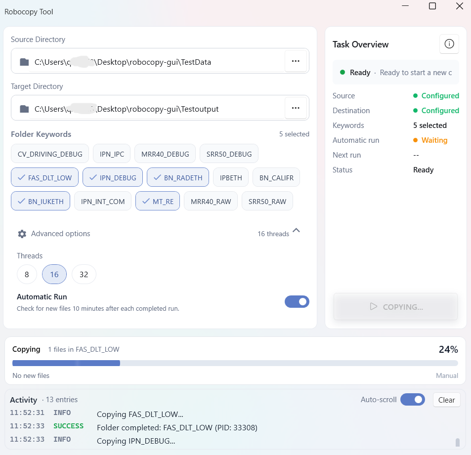

# Robocopy Tool

A modern Windows desktop tool for filtering and copying MF4 measurement files with Robocopy.

Built with WPF (.NET 10) and [WPF-UI](https://wpfui.lepo.co/) Fluent design — Mica backdrop, light theme, card-based layout.




## Features

- **Folder keyword filtering** - Filter subfolders by 14 predefined keywords, multi-select supported
- **MF4-only copying** - Copy only `.MF4` measurement files
- **Incremental copying** - Skip existing destination files (no overwrite)
- **Automatic Run** - Automatically repeat the copy cycle 10 minutes after each completed run
- **Live transfer progress** - Always-visible progress strip with percentage, current item, file count and shimmer animation
- **In-memory Activity view** - Real-time log display without disk writes
- **Single-file executable** - Self-contained Windows executable, no runtime installation needed
- **Fluent UI** - WPF-UI 4.3.0 `FluentWindow` with Mica backdrop and light theme

## Download & Run

Grab the single-file executable from `release/RobocopyTool.exe` (~78 MB) — the .NET 10 runtime is embedded, so there is nothing to install. Just run it.

Alternatively, publish it yourself (see below).

## Build

Requirements: Windows 10/11, [.NET 10 SDK](https://dotnet.microsoft.com/), Windows built-in Robocopy.

```bash
dotnet restore
dotnet build -c Debug
```

## Publish (single-file EXE)

```bash
dotnet publish MF4CopyStudio.csproj -c Release -r win-x64
```

Output: `bin/Release/net10.0-windows/win-x64/publish/RobocopyTool.exe`, then copy it to `release/` (convenience script: `build-release.cmd`).

Publish settings (already configured in the `.csproj`): `SelfContained=true`, `PublishSingleFile=true`, `EnableCompressionInSingleFile=true`, `IncludeNativeLibrariesForSelfExtract=true`, embedded debug info, no trimming (WPF + reflection-safe).

## Usage

1. Set **Source Directory** (folder containing keyword-matched subfolders)
2. Set **Target Directory**
3. Select one or more **Keywords** (default: `MT_RE`)
4. Click **START** — the tool scans matching folders, then robocopies each folder's `.MF4` files
5. Optional: enable **Automatic Run** for periodic re-checks (10 min after each completed run)
6. Optional: expand **Advanced options** to switch thread count (8/16/32)

The right-hand **Task Overview** card always keeps the START button pinned to the card bottom; the status summary and detail list above it scroll when the window is small. The window works down to 680×440.

## Safety

- Does **not** use `/MIR` (no mirroring, no deletion)
- Does **not** delete source or destination files
- Copies **only** `.MF4` files
- Existing destination files are **not overwritten** (`/XC /XN /XO`)

## Settings

Stored in `%LOCALAPPDATA%\RobocopyTool\settings.json`:

- Last used source/destination paths
- Selected keywords
- Thread count
- Automatic Run preference

## Project Structure

```
robocopy-gui/
├── App.xaml(.cs)              # Application entry, theme init, diagnostic modes
├── MainWindow.xaml(.cs)       # Main window: two-column card layout + progress + activity log
├── AboutWindow.xaml(.cs)      # About dialog (version, license)
├── LicenseWindow.xaml(.cs)    # Embedded MIT license viewer
├── Controls/
│   ├── PathPicker.xaml(.cs)   # Labeled path input with browse button
│   └── TransferProgressControl/
├── Converters/
│   └── IntToBoolConverter.cs  # RadioButton <-> int thread count
├── Models/                    # AppSettings, KeywordOption, LogEntry, CopyProgressInfo, ...
├── Services/
│   ├── FolderScanService.cs   # Keyword folder matching
│   ├── RobocopyService.cs     # Robocopy process wrapper + output parsing
│   ├── PathValidationService.cs
│   └── SettingsService.cs     # JSON settings persistence
├── ViewModels/
│   └── MainViewModel.cs       # MVVM logic, copy pipeline, automatic-run scheduler
├── Styles/                    # Design tokens, colors, button/scrollbar styles
├── Assets/                    # Application icon
├── release/                   # Final single-file EXE (not tracked by git)
└── LICENSE                    # MIT
```

## UI Framework & Design System

- **WPF-UI 4.3.0** provides `FluentWindow`, `TitleBar`, Mica backdrop (`ExtendsContentIntoTitleBar=True`)
- Theme tokens live in three merged dictionaries loaded in order: `Styles/DesignTokens.xaml` → `Styles/Colors.xaml` → `Styles/Buttons.xaml`; `ModernScrollBars.xaml` supplies the thin overlay scrollbars used by every `ScrollViewer`
- The window is a single `Grid` with four rows: title bar / main workspace (two columns: configuration card + task overview card) / global progress strip / activity log
- Cards are `Border` elements with token-driven corner radius, background and padding; the START button is pinned to the last row of the task-overview card so it is visible at any window size
- The copy pipeline can run entirely independently of window size: the progress strip (`GlobalProgressHost`) is always visible and never collapses

## Diagnostics

The app ships three headless/verification switches (see `App.xaml.cs`):

| Flag | Purpose |
|---|---|
| `--verify-ui` | Creates the window, waits for `Loaded`, writes `verify-ui-success.json` (or `verify-ui-error.json`) to `%TEMP%\MF4CopyStudio-Diagnostics\`, then exits. Catches XAML parse and startup crashes — not visual issues. |
| `--layout-probe` | Builds the window, then dumps **in-process** layout geometry (DIP units, `TranslatePoint`-based) of the layout root, both cards, the progress host and the START button to `layout-probe.txt`. Also reports the largest effective min-width contributor. Use this to debug clipping/spacing — it is immune to DPI and multi-monitor coordinate ambiguity that plagues screen-capture forensics. |
| `MF4COPY_DIAGNOSTICS=1` (env) | Enables startup diagnostics file output during normal runs. |

Sample `--layout-probe` output:

```
DPI: 1
Window: ActualWidth=800.0 ActualHeight=500.0
ConfigurationCard:  L=10.0  T=48.0  R=538.0 B=294.0 W=528.0 H=246.0
GlobalProgressHost: L=12.0  T=306.0 R=788.0 B=384.0 W=776.0 H=78.0
StartButton:        L=576.0 T=216.0 R=764.0 B=260.0 W=188.0 H=44.0
TaskOverviewLayout: L=576.0 T=74.0  R=764.0 B=260.0 W=188.0 H=186.0
MaxEffectiveMinWidth: 254.0 on TextBlock:GlobalProgressCurrentItemText
```

## Development Notes

Layout and tooling lessons learned while building this UI, kept here so they don't get re-learned the hard way:

### 1. Stretch buttons + `MinWidth` = silent clipping
The START button fills its card slot (`HorizontalAlignment="Stretch"`). It originally carried `MinWidth="200"`; when the window shrank, the card slot became narrower (188 DIP at 800×500) and the button element **overflowed its slot** — WPF renders the element at 200 DIP but paints only within the 188 DIP slot, leaving a background-colored strip that looks exactly like "the button is cut off on the right".

**Rule:** for stretch-filling buttons, drop `MinWidth` — the slot itself is the constraint.

### 2. Pin-to-bottom pattern
To keep a primary action always visible with scrollable content above it:

- The card must sit in a `*`-height row of its parent (a card in an `Auto` row grows with content instead of being constrained by the window).
- Inside the card grid: header in an `Auto` row, a `ScrollViewer` in a `*` row, the button in a final `Auto` row.
- A `ScrollViewer` placed in an **`Auto`** row never scrolls — it expands to its content's natural height. It only scrolls when something above it (the `*` row) gives it a bounded viewport.

### 3. Don't fight margins pairwise
Outer container margins and inner card margins must stay symmetric (both cards here carry a 12px bottom margin; the outer grid contributes none). Fixing one side without the other shows up as "cards too close to the progress bar".

### 4. Measuring WPF layout from outside the process is unreliable
UIAutomation rects include invisible window borders; screen captures through PowerShell/Python run into DPI virtualization and multi-monitor coordinate offsets; `Add-Type` may refuse to compile under redirected TEMP. When in doubt, extend `--layout-probe` and measure **inside** the process in DIP.

### 5. Cross-run state must be reset — or the second run breaks
Two production bugs, one pattern: per-run state that is *written but never cleared* poisons every subsequent cycle.

- **Concurrency gate**: a `SemaphoreSlim(1,1)` acquired with `WaitAsync` at cycle start but never `Release()`d in `finally`. The first cycle ran fine; every later START and every automatic run was rejected with *"Another task is already running."*
- **Progress dedup keys**: `_processedFileKeys` collects every copied filename for de-duplication, but `ResetProgress()` — the method that clears it — was defined and never called. Cycle 2 actually copied files (robocopy is an external process, it works regardless) while the progress bar sat at *Preparing* forever, because every output line was deduplicated to "already counted".

**Rule:** audit every per-run collection/gate for a matching *release* and *reset* on the cycle path. `finally` is where gates are returned; cycle start is where counters/keys/animation reset.

### 6. Copy pipeline details
Each selected keyword folder gets its own robocopy invocation with:

```
/Z /R:2 /W:2 /MT:{ThreadCount/8} /BYTES /ETA /XJ /FP /NDL /NJH /NJS /XC /XN /XO
```

`/MT` maps 8/16/32 threads to `/MT:1|2|4` (robocopy's own multiplier). `/XC /XN /XO` provide the incremental skip-existing behavior; `/XJ` avoids junction loops.

### Version history

| Version | Changes |
|---|---|
| 1.0.0 | Initial release: keyword filtering, MF4-only copying, incremental skip, automatic run, activity log (.NET 8) |
| 1.1.0 | Retarget to .NET 10; WPF-UI 4.3.0 FluentWindow + Mica light theme; always-visible progress strip with shimmer; START button pinned to card bottom with scrollable overview (fixes button clipping at small window sizes); symmetric card margins; `--layout-probe` diagnostics; single-file publish to `release/` |
| 1.2.0 | All controls migrated to native WPF-UI (`ui:Button`, `ui:ToggleSwitch`, `ui:SymbolIcon`); unified low-saturation steel-blue accent (`#5B7BC7`) via `ApplicationAccentColorManager` + window-scope palette re-seed; START button drop shadow; de-nested Task Overview card; Task Overview value column left-aligned; transparent Activity panel (border only); compact Activity header. Bug fixes: run semaphore released in `finally` (second manual START and automatic second run no longer rejected with "another task is already running"); `ResetProgress()` wired at cycle start (progress bar no longer stuck at *Preparing* during the second copy cycle); auto-run countdown race hardened with a local CTS |

## Third-party Dependencies

- **CommunityToolkit.Mvvm** - MVVM helpers ([MIT License](https://licenses.nuget.org/MIT))
- **WPF-UI (Wpf.Ui)** - Fluent UI controls ([MIT License](https://licenses.nuget.org/MIT))

Third-party dependencies remain subject to their respective licenses.

## License

This project is licensed under the [MIT License](LICENSE).

Copyright (c) 2026 Liu Pengfei
